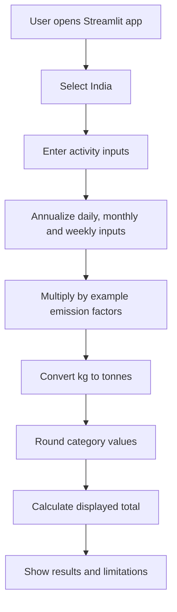
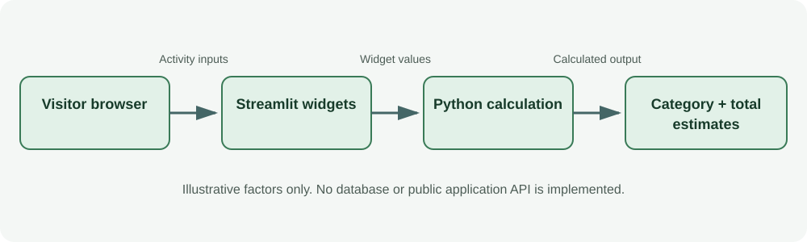
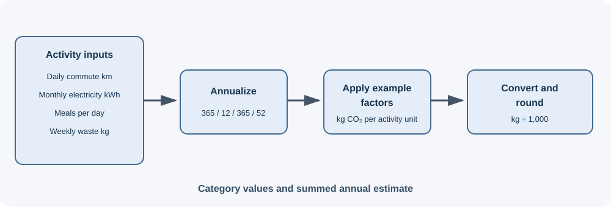

# 🌍 Personal Carbon Calculator

<p align="center">
  <strong>Understand everyday activity estimates. Explore the categories. Learn where calculation assumptions matter.</strong>
</p>

<p align="center">
  
  
  
  
  
</p>

> [!CAUTION]
> **This project is an educational prototype, not a scientifically validated carbon-accounting tool.** The factors currently hard-coded in `app.py` are example values without documented sources, data years, boundaries, uncertainty ranges, or independent validation. Do not use results for regulatory reporting, sustainability claims, procurement, investment, policy, or other consequential decisions.

---

## 📑 Table of Contents

- [🌱 Overview](#-overview)
- [✨ Current Features](#-current-features)
- [🧮 Calculation Model](#-calculation-model)
- [🗺️ Application Workflow](#️-application-workflow)
- [🧰 Technology Stack](#-technology-stack)
- [🚀 Installation and Setup](#-installation-and-setup)
- [🖥️ Running the Application](#️-running-the-application)
- [📂 Project Structure](#-project-structure)
- [📊 Factors and Assumptions](#-factors-and-assumptions)
- [🔐 Privacy and Data Handling](#-privacy-and-data-handling)
- [🧪 Testing and Quality](#-testing-and-quality)
- [♿ Accessibility](#-accessibility)
- [🚀 Deployment](#-deployment)
- [🛣️ Roadmap](#️-roadmap)
- [🤝 Contributing](#-contributing)
- [🆘 Support](#-support)
- [📜 License](#-license)

## 🌱 Overview

**Personal Carbon Calculator** is a small Python application built with Streamlit. It demonstrates how activity data can be annualized, multiplied by emission-factor examples, and presented as category-level estimates.

The current application is intentionally narrow. It supports one country selection, India, and four activity inputs. It does not represent every source of an individual's greenhouse-gas emissions.

### 🎯 Project goals

- Make the relationship between activity data and emission estimates easier to understand.
- Present category-level outputs rather than hiding all activity in one number.
- Keep assumptions and limitations visible.
- Provide a foundation for future, source-backed methodology improvements.
- Encourage transparent, testable, and responsible environmental software.

## ✨ Current Features

| Feature | Current behavior |
|---|---|
| 🌍 Country selection | India only |
| 🚗 Transportation | Daily commute distance in kilometres |
| 💡 Electricity | Monthly electricity use in kWh |
| 🍽️ Diet | Number of meals per day |
| 🗑️ Waste | Waste generated per week in kilograms |
| 📅 Annualization | Daily × 365, monthly × 12, weekly × 52 |
| 📊 Results | Four category estimates and a summed annual estimate |
| 🧩 Interface | Streamlit controls and result panels |

**Not implemented:** accounts, database, history, CSV/PDF export, live factor API, multi-country factor database, public REST API, payments, admin dashboard, or complete lifecycle accounting.

## 🧮 Calculation Model

The current code performs the following transformations:

| Category | Input | Annualized quantity |
|---|---|---|
| 🚗 Transport | Daily distance (km) | Daily distance × 365 |
| 💡 Electricity | Monthly consumption (kWh) | Monthly consumption × 12 |
| 🍽️ Diet | Meals per day | Meals × 365 |
| 🗑️ Waste | Weekly waste (kg) | Weekly waste × 52 |

For each category, the annualized activity quantity is multiplied by the corresponding hard-coded example factor. Kilograms are divided by 1,000 to display tonnes. The code rounds each category to two decimal places before adding those displayed values to form the total.



See [docs/architecture.md](docs/architecture.md) for the exact implementation and [docs/methodology.md](docs/methodology.md) for the evidence required before these values can be trusted.

## 🗺️ Application Workflow





## 🧰 Technology Stack

| Technology | Purpose |
|---|---|
| 🐍 Python | Application runtime and calculations |
| 🎈 Streamlit | Interactive web interface |
| 🧾 Markdown | Documentation and project guides |
| ⚙️ GitHub Actions | Repository quality checks |

The project currently consists of a single application file, `app.py`. It does not currently declare a pinned dependency manifest or supported Python version.

## 🚀 Installation and Setup

### Prerequisites

- Python 3 installed and available on your command line.
- Git installed.
- Internet access to install Streamlit.
- A terminal or command prompt.

### 1. Clone the repository

```bash
git clone https://github.com/Brajesh31/carbon-calculator.git
cd carbon-calculator
```

### 2. Create a virtual environment

**Windows PowerShell**
```powershell
python -m venv .venv
.venv\Scripts\Activate.ps1
```

**macOS / Linux**
```bash
python3 -m venv .venv
source .venv/bin/activate
```

### 3. Install Streamlit

```bash
python -m pip install --upgrade pip
python -m pip install streamlit
```

> [!NOTE]
> Streamlit is installed directly because the repository does not yet define a requirements file or lockfile. This means different dates or environments may install different dependency versions. A reproducible dependency policy is tracked in the roadmap.

## 🖥️ Running the Application

From the repository root:

```bash
python -m streamlit run app.py
```

Streamlit prints a local address, normally `http://localhost:8501`. Open it in your browser. Enter sample values and select **Calculate CO2 Emissions** to display the estimates.

To stop the development server, press `Ctrl+C` in the terminal.

### 🧪 Suggested first run

1. Leave all inputs at zero and calculate.
2. Enter a small commute distance and calculate.
3. Change electricity, meals, and waste independently.
4. Compare category changes.
5. Read the methodology warning before interpreting the total.

Use fictional or non-sensitive values.

## 📂 Project Structure

```text
carbon-calculator/
├── .github/
│   ├── ISSUE_TEMPLATE/
│   │   ├── bug_report.yml
│   │   ├── feature_request.yml
│   │   └── methodology_change.yml
│   ├── PULL_REQUEST_TEMPLATE.md
│   └── workflows/
│       ├── quality.yml
│       └── link-check.yml
├── docs/
│   ├── assets/
│   │   ├── application-flow.svg
│   │   ├── calculation-data-flow.svg
│   │   └── README.md
│   ├── decisions/
│   │   ├── 0001-streamlit-prototype.md
│   │   ├── 0002-factor-provenance.md
│   │   └── README.md
│   ├── templates/
│   │   ├── adr-template.md
│   │   ├── methodology-review-template.md
│   │   ├── test-report-template.md
│   │   ├── release-checklist.md
│   │   ├── change-proposal-template.md
│   │   └── content-approval-template.md
│   ├── accessibility.md
│   ├── api.md
│   ├── architecture.md
│   ├── content-guide.md
│   ├── database.md
│   ├── deployment.md
│   ├── design-system.md
│   ├── development.md
│   ├── faq.md
│   ├── installation.md
│   ├── known-issues.md
│   ├── maintenance.md
│   ├── methodology.md
│   ├── performance.md
│   ├── privacy.md
│   ├── project-structure.md
│   ├── release-process.md
│   ├── security.md
│   ├── testing.md
│   └── troubleshooting.md
├── app.py
├── CHANGELOG.md
├── CITATION.cff
├── CODE_OF_CONDUCT.md
├── CONTRIBUTING.md
├── LICENSE
├── README.md
├── ROADMAP.md
├── SECURITY.md
└── SUPPORT.md
```

## 📊 Factors and Assumptions

The source currently contains these example values:

| Category | Value in source | Implied unit |
|---|---:|---|
| Transportation | 0.14 | kg CO₂ / km |
| Electricity | 0.82 | kg CO₂ / kWh |
| Diet | 1.25 | kg CO₂ / meal (label) |
| Waste | 0.1 | kg CO₂ / kg waste |

These values have no documented provenance in the repository. There are also unresolved dimensional and boundary questions:

- The commute input does not distinguish one-way from return distance or ask for commute days per year.
- The diet factor's code comment refers to a per-kilogram basis, while the calculation multiplies by meals.
- Electricity intensity depends on geography and reporting period, neither of which is represented by the current single factor.
- Waste emissions depend on material composition and treatment pathway.
- The comparison statement in the app is hard-coded and uncited.
- The output is labeled CO₂ and should not be represented as a full CO₂-equivalent lifecycle footprint.

**Do not treat these numbers as official, current, or scientifically validated.** Read [the methodology guide](docs/methodology.md).

## 🔐 Privacy and Data Handling

There is no login, database, explicit result persistence, analytics integration, or export in the current code. Streamlit sends widget values to the Python process serving the app for the active session. Hosting-provider logs, telemetry, and retention are outside this repository's control.

Do not enter identifying or sensitive information. Read [docs/privacy.md](docs/privacy.md) before proposing data storage or third-party integrations.

## 🧪 Testing and Quality

Current automated checks cover Python syntax and relative Markdown links. They do not validate scientific accuracy, UI behavior across browsers, accessibility conformance, or hosted deployment.

- Run the app manually using the instructions above.
- Check zero and representative values.
- Independently verify any calculation change.
- Record environment and test evidence in pull requests.
- Do not confuse a passing CI workflow with scientific validation.

See [docs/testing.md](docs/testing.md).

## ♿ Accessibility

Use labeled controls, keyboard-operable interactions, visible focus, clear units, text-based warnings, and meaningful result headings. No formal accessibility audit is claimed. See [docs/accessibility.md](docs/accessibility.md).

## 🚀 Deployment

The application entry point is `app.py`. Streamlit Community Cloud or another compatible Python host can run it, but the repository does not include a deployment manifest or production infrastructure. Follow [docs/deployment.md](docs/deployment.md) and validate the host configuration independently.

## 🛣️ Roadmap

- [ ] Find and review credible, reusable sources for every emission factor.
- [ ] Correct unit inconsistencies and clarify commute assumptions.
- [ ] Replace or remove the uncited comparison statistic.
- [ ] Separate calculation logic from Streamlit UI.
- [ ] Add independently derived unit and boundary tests.
- [ ] Declare supported Python and Streamlit versions.
- [ ] Improve accessibility and show assumptions beside results.
- [ ] Consider export, history, and broader categories only after privacy and methodology review.

See [ROADMAP.md](ROADMAP.md) for details and priorities.

## 🤝 Contributing

Contributions that improve transparency, correctness, accessibility, testing, and maintainability are welcome.

1. Read [CONTRIBUTING.md](CONTRIBUTING.md).
2. Search existing issues and use the relevant issue template.
3. For a factor change, provide source, date, geography, unit, boundary, gas basis, license, and an independent calculation.
4. Explain tests and remaining limitations in the pull request.
5. Update affected documentation and [CHANGELOG.md](CHANGELOG.md).

## 🆘 Support

- Read [docs/faq.md](docs/faq.md).
- Check [docs/troubleshooting.md](docs/troubleshooting.md).
- Open a reproducible issue for bugs or feature proposals.
- Report vulnerabilities privately using [SECURITY.md](SECURITY.md).

## 📜 License

This project is distributed under the MIT License. See [LICENSE](LICENSE). Citation metadata is available in [CITATION.cff](CITATION.cff).
