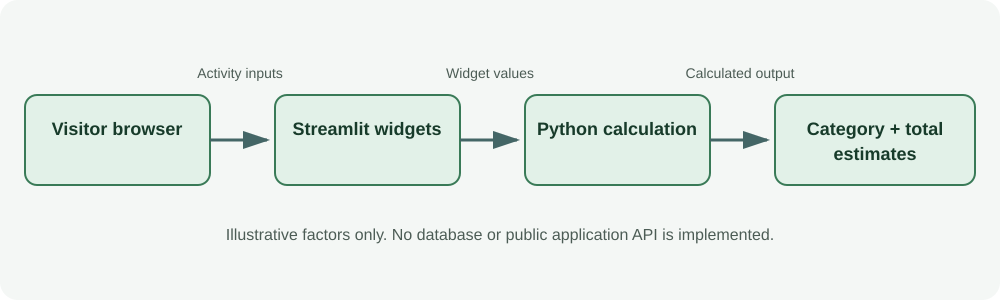
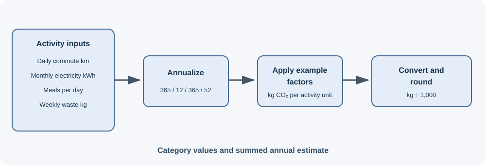

# 📚 Documentation Hub

This documentation describes the current Streamlit prototype and the practices required to maintain it responsibly. It does not certify the calculator's factors or results.

## 🧭 Recommended reading paths

### 👤 App users
1. [Installation](installation.md)
2. [FAQ](faq.md)
3. [Methodology and limitations](methodology.md)
4. [Privacy](privacy.md)
5. [Known issues](known-issues.md)

### 🧑‍💻 Contributors
1. [Development workflow](development.md)
2. [Architecture](architecture.md)
3. [Project structure](project-structure.md)
4. [Testing](testing.md)
5. [Accessibility](accessibility.md)
6. [Contribution guide](../CONTRIBUTING.md)

### 🛠️ Maintainers
1. [Deployment](deployment.md)
2. [Security](security.md)
3. [Maintenance](maintenance.md)
4. [Release process](release-process.md)
5. [Troubleshooting](troubleshooting.md)

## 📖 Complete documentation catalogue

| File | Purpose |
|---|---|
| [architecture.md](architecture.md) | Current app components, flow, formulas |
| [methodology.md](methodology.md) | Factor provenance, units, boundaries, uncertainty |
| [project-structure.md](project-structure.md) | Repository map and responsibilities |
| [development.md](development.md) | Local development and review workflow |
| [installation.md](installation.md) | Environment setup and startup |
| [testing.md](testing.md) | Automated checks and manual validation |
| [accessibility.md](accessibility.md) | Keyboard, screen reader, contrast review |
| [privacy.md](privacy.md) | Inputs, processing, storage boundaries |
| [database.md](database.md) | Current absence of persistence |
| [api.md](api.md) | Current absence of public API |
| [deployment.md](deployment.md) | Hosting and deployment guidance |
| [security.md](security.md) | Project-specific security notes |
| [faq.md](faq.md) | Usage and interpretation questions |
| [troubleshooting.md](troubleshooting.md) | Common setup and runtime issues |
| [known-issues.md](known-issues.md) | Confirmed gaps |
| [maintenance.md](maintenance.md) | Routine upkeep and handover |
| [release-process.md](release-process.md) | Release checklist and versioning proposal |
| [content-guide.md](content-guide.md) | Responsible wording and claims |
| [performance.md](performance.md) | Current performance profile |
| [design-system.md](design-system.md) | UI consistency principles |
| [assets/](assets/README.md) | Diagrams |
| [templates/](templates/README.md) | Reusable project templates |
| [decisions/](decisions/README.md) | Architecture decision records |

## 🗺️ Diagrams

## ✅ Current implementation snapshot

- Entry point: root `app.py`.
- Interface: Streamlit.
- Country selector: India only.
- Inputs: daily commute km, monthly electricity kWh, weekly waste kg, meals per day.
- Factors: hard-coded examples with no documented provenance.
- Database, authentication, export, and public API: not implemented.
- Dependency lock or pinned runtime: not present.
- Automated checks: Python syntax and local Markdown links only.

Update this snapshot when implementation changes.
