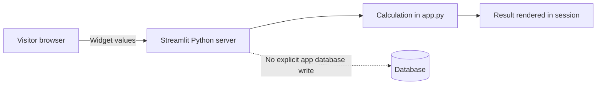

# 🔐 Privacy and Data Handling

## Current data flow

The current source has no login, database, external application API, analytics integration, or explicit export. Streamlit sends widget values to the Python process serving the app. The script uses them in the active session to calculate and render results.

This diagram describes explicit application behavior only. It does not guarantee that the hosting platform has no logs, telemetry, backups, or retention. Those controls are outside this repository.

## Data minimization

The app asks for activity quantities and a country selection. It does not require names, email addresses, home addresses, precise locations, or credentials. Avoid entering identifying or sensitive information.

## Before adding persistence or analytics

Document the purpose, exact fields, processing locations, providers, access roles, retention, deletion, backups, encryption, user notice, correction/export/deletion routes, and suitability for minors. Do not call data anonymous merely because a name field is absent; detailed household patterns can be sensitive in context.

## Incident response

Restrict access where practical, preserve evidence, rotate affected credentials, assess possible exposure, and follow the hosting provider's incident process. Never put personal data in a public issue. See [SECURITY.md](../SECURITY.md).
